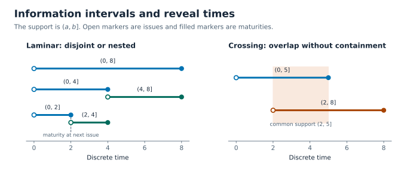
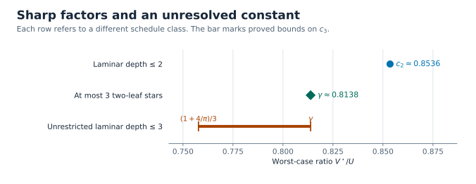
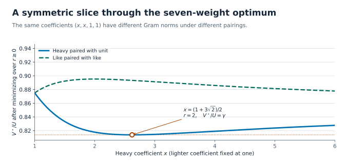

# Filtered Variance Extremals

**Sharp worst-case variance comparisons for conditionally centered scores on deterministic information intervals.**

A score is issued at time $a_i$, observed at $b_i$, bounded by one, and centered conditionally on the information at issue. Write $V^\star$ for the supremum variance of a deterministically weighted sum over admissible filtered laws. The covariance relaxation $U$ keeps unit diagonals, positive semidefiniteness, and zero covariance for disjoint supports. How much does it lose by dropping the full issue-time constraints?

For a laminar schedule, a single recursively constructed law attains the maximum of every convex payoff of the weighted total. The stochastic recursion and the exact Gram recursion then give sharp comparisons on specified tree classes. The unrestricted depth-three problem remains open.

**Technical manuscript, version 1.0 — 18 November 2026**

[Manuscript PDF](manuscript/manuscript.pdf) · [LaTeX source](manuscript/manuscript.tex) · [Reproducibility guide](REPRODUCIBILITY.md) · [Citation metadata](CITATION.bib)

## Model and results

The supports are distinct positive-length half-open intervals $(a_i,b_i]$ on a discrete clock. Write $\mathcal F_t$ for the information at time $t$. A score $X_i$ is $\mathcal F_{b_i}$-measurable, satisfies $|X_i|\leq1$, and has $\mathbb E[X_i\mid\mathcal F_{a_i}]=0$. All maturities at $a_i$ are already observable at that issue. Weights are real and deterministic. A schedule is laminar when every pair of supports is disjoint or nested.

| Domain | Established result | Main proof ingredient |
|---|---|---|
| Arbitrary deterministic interval schedule in the model | Exact sign linear program with one conditional equation per matured-sign history | Independent endpoint rounding and minimal-filtration realization |
| Finite laminar forest | Attainable conditional convex-order maximum and exact Gram recursion | Backward conditional comparison and admissible independent canonical children |
| Laminar depth at most two | Sharp factor $c_2=(1+1/\sqrt2)/2$ in $V^\star\geq c_2 U$ | Exact star reduction and sharp real Khintchine |
| One root, at most two child stars, at most two active leaves in each | Sharp factor $\gamma=3/(15-8\sqrt2)$ | Analytic global minimization over magnitudes and pairings |
| One root, at most three child stars, at most two active leaves in each | Same sharp factor $\gamma$ | Analytic reduction and exact coverage of the six-coordinate coefficient cone |
| Unrestricted laminar depth at most three | $(1+4/\pi)/3\leq c_3\leq\gamma$ | Gaussian rounding and an attaining restricted witness |

Sharpness refers to the indicated class over schedules and weights. The witness for $\gamma$ uses outer magnitude $2$, two child root magnitudes $(3\sqrt2-1)/2$, and two unit leaf magnitudes in each active star. Additional weights are zero. With three positive child totals the inequality is strict. The infimum remains $\gamma$ over that subclass and is approached on a tree that can carry the two-star witness as the third star vanishes.

**Open.** The exact value of $c_3$ and the uniform four-star inequality are undetermined. The four-star results in the manuscript are limited to stated slices and selected chambers. The upper comparisons concern worst attainable variances. They give no positive lower bound on the variance of an individual process.

## Why the pairing matters

In the displayed slice the effective coefficients are $(x,x,1,1)$ with $x\geq1$. Both pairings give the same first absolute moment and second moment. Their Gram norms differ, so their quotients differ after minimizing over the outer weight $r\geq0$. The marked point is the analytic equality witness.

## Reproduce the three-star certificate

Run from the repository root with Python 3.12 and assertions enabled:

~~~sh
python -I -B scripts/check_artifacts.py
python -I -B certificate/verify_s07.py certificate/three-star-tape.txt
python -I -B certificate/verify_s08.py certificate/three-star-tape.txt
python -B -m unittest discover -s tests -v
~~~

The first command checks source, PDF, checker and certificate digests. The next two verify the same saved subdivision and active-set plan by two exact implementations. The main replay covers 21 maximal chambers and all 15 matchings, with the dominant chamber handled analytically. It checks 300 root cases, 1,854 nodes, 1,077 terminal certificates and 34 tight directions using arithmetic in $\mathbb Q(\sqrt2)$. The tests exercise the Python reference recursions and full-history validation on fixed examples. They are separate from the finite proof. The guide includes the optional geometry replay and figure-rendering commands.

## Connections and attribution

The fair-sign root step uses conditional convex order and comonotone maximization. The depth-two constant uses the classical sharp real Khintchine inequality. Hausmann–Rodriguez classified the equivalent polygon-length chamber arrangement. Fang–Wang's Theorem 1 establishes the related four-coordinate Rademacher profile at fixed distance. The variance ratio studied here also depends on the matching and the outer weight. The manuscript gives the primary references and compares the optimization domains.

### AI Assistance and Scientific Responsibility

This project was developed with substantial generative-AI assistance, extending beyond writing and programming to mathematical exploration, proof development, exact computational verification, literature research, and scientific review.

The research is presented under the responsibility of its human author. AI-based reviews are not equivalent to independent human peer review. Mathematical claims, source code, and reproducible certificates are provided for independent scrutiny.

## Citation and permissions

Use [CITATION.bib](CITATION.bib) and record the exact commit when referring to this repository. The bibliography for the mathematical sources is in [manuscript/references.bib](manuscript/references.bib). Jonas Weingart is the author. The [license scope and file inventory](LICENSE_SCOPE.md) identify the terms for the code, manuscript, figures, and certificate dataset. Font and dependency attributions are in the [third-party notices](THIRD_PARTY_NOTICES.md).
